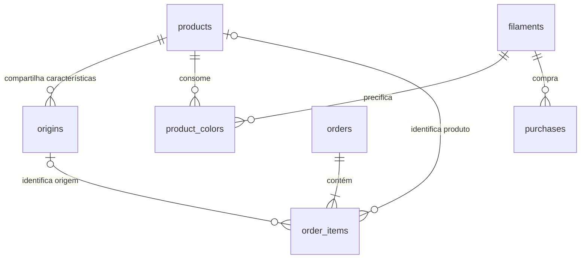

# Arquitetura e modelo de dados

Projeto novo, sem código, bancos, módulos ou instaladores de versões anteriores. Aplicativo monousuário local, Python 3.12, PySide6/Qt Widgets, SQLite da biblioteca padrão. Não há serviço web nem conexão externa durante o uso normal.

## Camadas

- `forgeon/ui`: janela, navegação, formulários, tabelas e prévias de confirmação. A interface chama serviços e importadores; não interpreta comandos dos arquivos.
- `forgeon/business`: validação de números, datas, dinheiro, precificação e operações de cadastro. Decimal nos cálculos, centavos inteiros no banco para dinheiro.
- `forgeon/db`: esquema, conexões, transações, auditoria, backup consistente e restauração.
- `forgeon/importers`: XLSX, modelos de cadastro, metadados 3MF e comentários G-code.
- `forgeon/reports`: cálculos financeiros e exportação XLSX com strings explícitas para impedir fórmulas.
- `tests`: regras de negócio, importadores, integridade e abertura das telas.

## Entidades

| Tabela | Finalidade e relacionamentos |
|---|---|
| products | Produto físico, modelo/tamanho, peso, horas, fabricação manual opcional, embalagem e outros custos. Arquivamento lógico. |
| filaments | Material, cor e preço de referência por kg. |
| product_colors | Relação produto × filamento e gramas por unidade. A soma substitui o peso manual. |
| origins | Canal, anúncio, variação, SKU textual e produto opcional. Várias origens podem apontar para um produto. |
| sku_codes | Registro permanente de códigos reservados, usados e aposentados. |
| orders | ID textual, data, status, total bruto, taxas e reembolso. Valores financeiros ficam aqui, uma vez por pedido. |
| order_items | Itens por pedido, origem, produto, SKU original, quantidade, preço unitário e custo congelado com composição e data. |
| stats | Anúncio e período de cobertura, receita e contagem de pedidos do resumo. Não cria itens nem pedidos. |
| expenses | Despesas por data, categoria e descrição. |
| purchases | Compra de filamento por material/cor, peso, valor e frete. |
| settings | Parâmetros de precificação e formato do próximo SKU. |
| audit | Histórico de operações de gestão sem dados pessoais de compradores. |
| meta | Identidade exclusiva deste projeto novo. |

O arquivo `forgeon/db/schema.sql` é a definição integral do banco. `application_id = 1179797298`, `user_version = 1` e `meta.project = forgeon-studio-erp-2-new` identificam o projeto. O número 1 é a versão do esquema, não uma versão antiga do Forgeon. Não há migração de bancos anteriores.

## Invariantes

1. Não há fusão automática de produtos. Sugestões com nomes normalizados são apenas orientações. Modelo e tamanho devem ser conferidos por uma pessoa; Sonic e Super Sonic permanecem distintos.
2. Um SKU não determina identidade física. O mesmo SKU pode aparecer em origens do mesmo produto; quando aponta para produtos diferentes, o catálogo mostra conflito em vermelho.
3. O registro de códigos não é apagado. O próximo numérico pula equivalentes com zeros à esquerda, códigos usados, reservados e aposentados.
4. Corrigir vínculo atualiza a identificação de itens associados e registra antes/depois. SKU original e custo já congelado não mudam. Desvincular uma origem desativa-a e preserva identificação e custos dos pedidos existentes.
5. Reimportar um pedido substitui seus itens identificados e atualiza seu cabeçalho dentro de uma única transação; pedidos ausentes no arquivo permanecem intactos. É necessário trazer todos os itens de cada ID incluído.
6. A chave estável do item é SHA-256 de nome de anúncio + variação + SKU original. Linhas iguais são agregadas por quantidade. Preços unitários diferentes para a mesma chave exigem revisão. Mudança desses identificadores pode criar um novo item e novo congelamento: revise a prévia e o backup.
7. Custos completos são congelados ao importar um item já vinculado. Itens incompletos ficam sem custo. A ação explícita de congelar pendentes usa valores e data atuais; não fabrica um custo histórico na data antiga da venda.
8. Estatísticas são independentes. Receita do resumo nunca entra na receita dos pedidos. Não existe geração de SKU ou variação a partir de estatísticas.
9. Chaves estrangeiras permanecem ativas. Consultas usam parâmetros; nomes de tabelas e comandos são definidos pelo aplicativo.
10. QLockFile bloqueia duas instâncias do aplicativo no mesmo diretório de dados. Isso não bloqueia editores SQLite de terceiros; não abra o banco em outro programa enquanto o ERP estiver em uso.

## Limites deliberados

O aplicativo não acompanha impressoras, anúncios publicados, IA, estoque contábil completo, emissão fiscal, integração automática de marketplace ou conciliação bancária. Compras e consumo são registrados para análise gerencial; não há controle de lotes nem custo médio de estoque automático. Não existe atualização automática ou publicação externa.

## HF02 — esquema 2

O script base `schema.sql` continua representando o esquema 1 deste projeto. A criação e atualização aplicam em seguida `migration_v2.sql`, acrescentando `order_financials` (componentes financeiros por pedido), `item_usage` (snapshot de consumo por item) e `product_slices` (origem da receita de impressão). Bancos existentes recebem backup consistente antes da conversão; backups de esquema 1 só são convertidos depois de validados em estágio local. A versão do esquema vigente é 2, e a identidade do projeto permanece a mesma. Campos de compradores não são incluídos. Consulte `HF02_PRODUCAO.md`.
